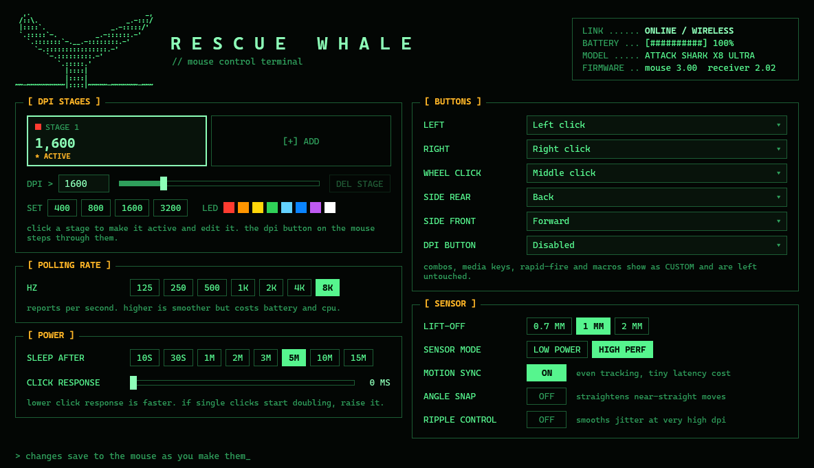

# Rescue Whale

A small, open-source settings app for gaming mice built on the Compx chipset (USB vendor ID `3554`), such as some Attack Shark models. Every setting is on one screen, and changes save to the mouse as you make them.



Rescue Whale is an independent project. It is not affiliated with, endorsed by, or supported by Attack Shark or Compx.

## What it does

- **DPI:** up to six stages from 50 to 42,000, each with an indicator color
- **Polling rate:** 125 Hz to 8,000 Hz
- **Buttons:** remap the six buttons to clicks, back/forward, DPI stepping, scrolling, polling-rate switching, or disabled
- **Sensor:** lift-off distance, sensor mode, motion sync, angle snapping, ripple control
- **Power:** sleep timer and click response (debounce) time
- **Status:** connection, battery level, model, and firmware version

It finds the mouse on its own, over the USB cable or the wireless receiver, and reconnects when the mouse wakes up.

## What it does not do

- Macros, key combinations, media keys, and rapid-fire. Any already on the mouse show as `CUSTOM` and are left untouched.
- Lighting effects and the receiver's LED
- Profiles
- Pairing and firmware updates. Use the manufacturer's software for those.

## Tested hardware

So far it has been tested on a single mouse, the Attack Shark X8 Ultra:

| Connection | USB ID | Status |
| --- | --- | --- |
| USB cable | `3554:FB43` | Works: settings read and save. |
| 8K wireless receiver | `3554:FB44` | Works: settings read and save. |

Other Compx-based mice may work. Before it writes anything, Rescue Whale checks that the settings it read from the mouse carry the checksums it expects, and switches to read-only if they don't. If you try it on another model, please open an issue with the result.

## Download and run

Download `RescueWhale.exe` from the Releases page and run it. There is nothing to install.

- `RescueWhale.exe` runs on any 64-bit Windows 10 or 11 PC.
- `RescueWhale-small.exe` is much smaller but needs the [.NET 10 Desktop Runtime](https://dotnet.microsoft.com/download/dotnet/10.0).

Windows may show a "Windows protected your PC" warning the first time, because the program is not code-signed. Choose **More info**, then **Run anyway**.

Close the manufacturer's software before using Rescue Whale, so the two don't write to the mouse at the same time.

To look around without a mouse connected, start it in demo mode:

```
RescueWhale.exe --demo
```

## Privacy

Rescue Whale has no telemetry, makes no network connections, and stores nothing on your PC. Your settings live only on the mouse.

## Build from source

You need the [.NET 10 SDK](https://dotnet.microsoft.com/download/dotnet/10.0) on Windows.

```
dotnet build
dotnet run
```

To produce the single-file release build:

```
dotnet publish -c Release -r win-x64 --self-contained true -p:PublishSingleFile=true -p:IncludeNativeLibrariesForSelfExtract=true -p:EnableCompressionInSingleFile=true -o dist
```

## How it talks to the mouse

The mouse exposes a vendor-defined HID collection (usage page `FF02`) that exchanges 17-byte reports. Each report carries a command, an address, a length, up to ten bytes of data, and a checksum. Settings live in a small block of memory on the mouse, where every value is stored alongside its own check byte.

- `Hid.cs` finds the device and sends and receives reports.
- `Mouse.cs` maps that memory to named settings.
- `MainWindow.xaml` and `MainWindow.xaml.cs` are the interface.

## License

[MIT](LICENSE)
